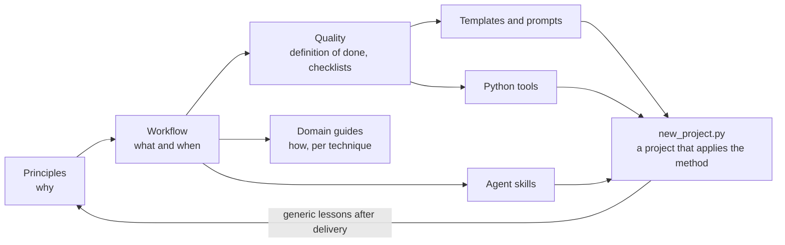

# AI-assisted visual production playbook

[](https://github.com/maoxor/ai-assisted-visual-production-playbook/actions/workflows/ci.yml)
[](LICENSE)

A field-tested **method and toolkit for producing visual work with an AI coding agent**: offline 3D renders, 2.5D
animation, looping background videos for the web and web interfaces. A person (the **lead**) sets the intent and
judges; the agent ([Claude Code](https://docs.claude.com/en/docs/claude-code/overview) in practice) researches,
builds, measures and documents. The playbook covers the whole path, from scoping to delivery, and keeps the result
**perceptibly better, verifiable and reproducible** at every step.

It documents **how to do the work**. It contains no project, deliverable or asset
([decision 0007](docs/decisions/0007-no-project-content.md)).

## The problems it solves

Agent-assisted visual work fails in recurring, expensive ways:

| Failure | What the playbook does about it |
|---|---|
| "Done" is announced when a render was merely launched | A [definition of done](docs/quality/README.md#definition-of-done): final files exist, open and were checked |
| Improvements are judged on stills, zoomed diagnostics or metrics | Judge in **final conditions** (final size, normal speed, whole piece, forward playback) ([P8](docs/principles.md#p8)) |
| Several changes at once, so nobody knows what helped | One variable at a time, on a sample, with a before/after ([evidence-based iteration](docs/workflow/04-evidence-based-iteration.md)) |
| A defect is hidden (global blur, disabled test) instead of fixed | Diagnosis by elimination and fixing at the cause ([P9](docs/principles.md#p9)) |
| An interrupted production silently mixes outputs of two versions | Fingerprinted, resumable production ([`fingerprint.py`](tools/README.md#fingerprintpy)) |
| Production cost drifts until iteration becomes impossible | Cost profile measured before any long run ([P13](docs/principles.md#p13)) |
| A request buried in a long message is forgotten; a replaced instruction is still applied | An [instruction register](templates/instruction-register.md), reviewed before every report |
| A new session cannot resume without the whole conversation | Logs, archived versions and a resume checklist ([continuity](docs/workflow/09-continuity.md)) |

Twenty of these failures are written up as [anti-patterns](docs/quality/anti-patterns.md), each with its symptom, cost
and prevention.

## What you get

| Component | Content | Use it to |
|---|---|---|
| [Method](docs/README.md) | 16 [principles](docs/principles.md), a 10-step [workflow](docs/workflow/README.md), a [quality](docs/quality/README.md) grid, 5 [checklists](docs/quality/checklists/README.md), [domain guides](docs/domains/README.md) | Decide what to do, in which order, and when it is finished |
| [Templates](templates/README.md) | 11 project documents (brief, instruction register, logs, delivery report…) and 11 [prompt templates](templates/prompts/README.md) | Start documents and requests from a proven structure |
| [Agent skills](skills/README.md) | `work-log`, `test-first-change`, `visual-iteration` (Agent Skills format), packaged as a Claude Code plugin | Make the agent follow the procedures without repeating them |
| [Hooks](hooks/README.md) | 3 Claude Code guards for rendering projects: archives read-only, dependencies of a running production frozen, no large files in Git | Enforce the rules automatically, whatever the agent does |
| [Tools](tools/README.md) | 6 tested Python command-line tools: flicker measurement, loop check, temporal stabilization, dependency fingerprint, review page, review video | Measure, protect and present visual results |
| [`scripts/new_project.py`](scripts/new_project.py) | Project scaffolder | Create a project that applies the method in one command |
| [`examples/demo.py`](examples/README.md) | End-to-end demonstration on synthetic frames | See every tool work in two minutes, without any project data |

## Quick start

Requirements: Git and Python 3.10 or later. [uv](https://docs.astral.sh/uv/) is recommended; pip works too. ffmpeg is
needed only for review videos. Details: [`GETTING_STARTED.md`](GETTING_STARTED.md#requirements).

```bash
git clone https://github.com/maoxor/ai-assisted-visual-production-playbook.git
cd ai-assisted-visual-production-playbook
```

**1. See the tools work (2 minutes).** The demo generates a synthetic looping sequence with sparkle flicker, measures
it, stabilizes it, checks the loop seam and builds a side-by-side review video and an offline review page:

```bash
uv run examples/demo.py --open
# without uv: python -m pip install numpy opencv-python-headless && python examples/demo.py --open
```

**2. Start a project that applies the method.**

```bash
python3 scripts/new_project.py ~/dev/my-project --name "My project"
```

It creates the agent instructions (`CLAUDE.md`), the document templates, the skills, the guard hooks and the tools,
and never overwrites an existing file. Then follow [`GETTING_STARTED.md`](GETTING_STARTED.md).

**3. Or install only the skills in Claude Code**, for every project:

```text
/plugin marketplace add maoxor/ai-assisted-visual-production-playbook
/plugin install visual-production@visual-production-playbook
```

**4. Read the method.** Ten minutes: the [principles](docs/principles.md). Then the [workflow](docs/workflow/README.md)
and the [anti-patterns](docs/quality/anti-patterns.md).

## How it works



- **Principles** explain why; the **workflow** says what to do and when; **quality** documents say when it is good
  enough; **domain guides** give procedures per technique. One rule lives in one place; everything else links to it.
- **Templates, skills and tools** turn the method into things an agent can follow and run.
- Every practice carries a **maturity level**, so you know what you can rely on:

  | Level | Meaning |
  |---|---|
  | **[proven]** | Applied in real production, with an observed effect |
  | **[extrapolated]** | Derived from proven practices for another context, not yet applied there |
  | **[proposed]** | New, written to fill a gap; still to be tried |

- **Roles.** The lead decides intent, references and final choices; their visual judgement wins over the agent's
  measurements. The agent decides what is reversible and asks before anything irreversible or external
  ([P12](docs/principles.md#p12)).

## Reuse and adapt

- **Another domain** (motion design, real time, documents): the [adaptation guide](docs/workflow/adapting.md) translates
  every concept (production unit, final conditions, sample, checks, costs).
- **Another art direction**: the method prescribes no style
  ([decision 0002](docs/decisions/0002-method-separate-from-aesthetics.md)); it transfers mechanisms, not looks.
- **Another agent**: the principles, workflow and tools are agent-agnostic. `AGENTS.md` points other agents to the same
  instructions; the skills use the open Agent Skills format.
- **Your own defaults**: [collaboration defaults](docs/quality/collaboration.md) are the authors' defaults; replace them
  in your project's instruction register.

## Scope and limitations

- **Proven on** offline 3D rendering delivered as web background video, 2.5D animation of a single illustration, and
  web applications. Other domains are [extrapolated] ([roadmap](ROADMAP.md)).
- **Tools and hooks are tested on synthetic data** in CI (Linux, macOS, Windows); their thresholds are starting
  points to validate on each project, never targets. The hooks are [proposed]: not yet used in a real production.
- **macOS-specific advice** is labelled as such (power management, Apple video colour).
- **Not a style guide, not a project archive, not a render engine.** The tools measure and protect results; they do
  not generate images.

## Documentation map

| I want to… | Read |
|---|---|
| Understand the philosophy in 10 minutes | [Principles](docs/principles.md) |
| Start a new project | [`GETTING_STARTED.md`](GETTING_STARTED.md) |
| Follow the full path from request to delivery | [Workflow](docs/workflow/README.md) |
| Know when work is done and how to judge it | [Quality](docs/quality/README.md) |
| Avoid classic mistakes | [Anti-patterns](docs/quality/anti-patterns.md) |
| Use a checklist | [Checklists](docs/quality/checklists/README.md) |
| Find methods per technique | [Domain guides](docs/domains/README.md) |
| Configure Claude Code and choose tools | [Tooling](docs/tooling/README.md) |
| Run or reuse a tool | [`tools/`](tools/README.md) |
| Start from a document or prompt template | [`templates/`](templates/README.md) |
| Install the agent skills | [`skills/`](skills/README.md) |
| Add automatic guards to a project | [`hooks/`](hooks/README.md) |
| Understand a structural decision | [Decisions](docs/decisions/README.md) |
| See what is planned | [`ROADMAP.md`](ROADMAP.md) |
| Contribute | [`CONTRIBUTING.md`](CONTRIBUTING.md) |
| Look up a term | [`GLOSSARY.md`](GLOSSARY.md) |

## Repository layout

```
docs/                  The method
  principles.md          why: sixteen project-independent principles
  workflow/              what and when: ten steps, exit criteria, adaptation
  quality/               how to judge: definition of done, grid, anti-patterns, checklists
  domains/               how, per technique: domain guides
  tooling/               with what: inventory, provenance and licensing, Claude Code
  decisions/             structural decisions about the method (ADR)
templates/             Document and prompt templates copied into projects
skills/                Agent skills (also the Claude Code plugin's skills)
hooks/                 Claude Code guard hooks for rendering projects
tools/                 Tested Python command-line tools
examples/              End-to-end demonstration on synthetic data
scripts/               Repository checks, project scaffolder
tests/                 Tests for tools, scripts and the demo
.claude-plugin/        Claude Code plugin and marketplace manifests
```

## Checking the repository

The repository checks itself locally and in CI ([`.github/workflows/ci.yml`](.github/workflows/ci.yml)):

```bash
python3 scripts/check_repo.py      # links, anchors, maturity levels, structure, confidentiality
uv run pytest                      # tools, scripts and demo tests
```

## Contributing, conduct, security, license

Contributions are welcome: lessons learned, method changes, tools, domain guides. Read
[`CONTRIBUTING.md`](CONTRIBUTING.md), the [code of conduct](CODE_OF_CONDUCT.md) and the
[security policy](SECURITY.md). Released under the [MIT license](LICENSE); the templates and skills may also be copied
into your projects without attribution (see [`LICENSE`](LICENSE)). To cite the playbook, use
[`CITATION.cff`](CITATION.cff) (GitHub's "Cite this repository" button).
