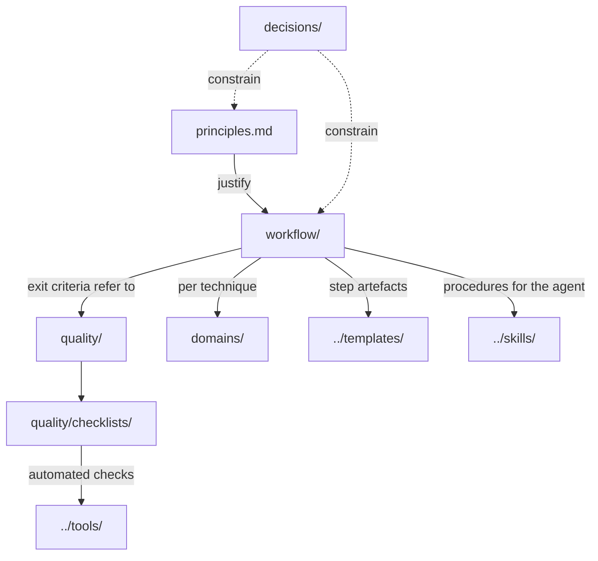

# Documentation

The method, in the order you would normally read it. Each document has one job; rules live in one place and the others
link to them.

| Document | Answers | Read it when |
|---|---|---|
| [`principles.md`](principles.md) | **Why**: sixteen principles independent of project, technique and style | First, then whenever a step must be adapted |
| [`workflow/`](workflow/README.md) | **What and when**: ten steps with inputs, outputs, exit criteria; typical sequences; adaptation | Planning or running a project |
| [`quality/`](quality/README.md) | **How good, and when to stop**: definition of done, evaluation grid, anti-patterns, collaboration defaults, checklists | Before presenting, producing or delivering |
| [`domains/`](domains/README.md) | **How, per technique**: offline 3D rendering, 2.5D animation, real-time web 3D, web background video, web applications, AI models and assets | Working in one of these domains |
| [`tooling/`](tooling/README.md) | **With what**: tool inventory, provenance and licensing, shared machines, Claude Code configuration | Setting up a workstation or adding a dependency |
| [`decisions/`](decisions/README.md) | **Why the method is shaped this way**: architecture decision records | Before proposing a structural change |

## How the pieces relate

- A **principle** states a rule and why it exists. A **workflow step** applies several principles at a given moment.
  A **checklist** turns a step's exit criterion into boxes ticked with evidence. A **domain guide** gives the concrete
  procedures of one technique. A **template** is the document a step produces; a **skill** is the procedure an agent
  follows; a **tool** automates a check.
- Anti-patterns ([A1 to A22](quality/anti-patterns.md)) and principles ([P1 to P16](principles.md)) have stable anchors
  (`#a1`, `#p1`…) so that projects can cite them.

## Conventions

- Maturity levels: **[proven]**, **[extrapolated]**, **[proposed]** ([README](../README.md#how-it-works)).
- Research claims: **D** documented, **T** tested, **H** hypothesis, **O** observation ([P4](principles.md#p4)).
- Roles: the **lead** decides and approves; the **agent** builds, checks and documents ([glossary](../GLOSSARY.md)).
