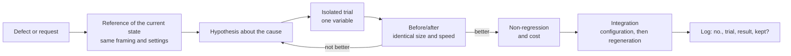

# 4. Evidence-based iteration

**Objective.** Improve the result through changes whose effect is demonstrated, without regression, and fix defects at
their cause. This is the core of the method.

## The loop

## Rules [proven]

1. **First produce a reference of the current state**, with the same settings as the trial. If it has to be rebuilt,
   check that it gives the same result (measured difference close to zero).
2. **One variable at a time** ([P6](../principles.md#p6)). Trials have short names (`e1`, `e2`…) and are produced by a
   bench that applies **named modifications** to an in-memory copy of the reference state; the reference is never
   touched.
3. **Diagnose by elimination** when the cause is not obvious
   ([technique](../domains/offline-3d-rendering.md#diagnosis-by-elimination)).
4. **Work on a sample** ([P7](../principles.md#p7)): a representative element or a crop at final quality; to judge
   motion, add a short camera or interaction move.
5. **Compare at identical framing, size and speed**, side by side and labelled:
   - **reference / before / after** when a target exists;
   - **current trial / new trial** while iterating;
   - **diagnostic view, then render with the final processing**;
   - **whole piece, in addition to close-ups**: a detail that is right in close-up can unbalance the whole.
6. **Compare several amplitudes or dosages** rather than a single value (×0.6, ×1, ×1.3, for example), and choose at
   normal speed and final size.
7. **Examine how a failed trial was built** instead of pushing its intensity. If a deformation cannot grow without
   stretching, look for another way to produce the perceived effect (shadow, colour, timing).
8. **Check what the result shows, not what the parameter says**: controller, deformation, evaluated texture, rebuilt
   scene, rendered image. A parameter can have no effect under some conditions ([A9](../quality/anti-patterns.md#a9)).
9. **Check that a change is perceptible before presenting it** ([A5](../quality/anti-patterns.md#a5)).
10. **Check for regressions**: the rest of the composition unchanged (element-by-element comparison), protected areas
    respected, cost stable.
11. **Integrate into the configuration**, then regenerate. Archive the configuration in force before any change.
12. **Write it in the log**: number, trial, finding, kept or rejected and why
    ([template](../../templates/experiment-log.md)).

## Warning signs

- "I can't see any difference": the trial was judged in a diagnostic view, not at final size.
- An aberrant timing: measure again before concluding (warm-up on the first pass, busy machine).
- A defect discovered on a version already shown: say so explicitly and show the fixed version.
- A possible misunderstanding of an instruction: restate what you understood in the report
  ([A17](../quality/anti-patterns.md#a17)).

## Exit criterion of an iteration

Before/after produced in final conditions; defect fixed at its cause; no regression detected; cost known; log up to
date; each request of the iteration listed with its status (done, trial rejected with its reason, missing).
