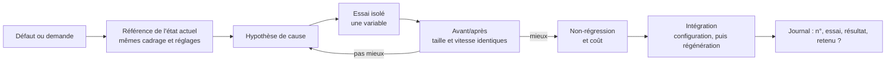

# 4. Itération sur preuves

**Objectif.** Améliorer le résultat par des changements dont l'effet est démontré, sans régression, et corriger les
défauts à leur cause. C'est le cœur de la méthode.

## La boucle

## Règles [éprouvé]

1. **Produire d'abord une référence de l'état actuel**, avec les mêmes réglages que l'essai. Si elle doit être
   reconstruite, vérifier qu'elle redonne le même résultat (écart mesuré proche de zéro).
2. **Une variable à la fois** ([P6](../principles.md#p6)). Les essais portent des noms courts (`e1`, `e2`…) et sont
   produits par un banc qui applique des **modifications nommées** à une copie en mémoire de l'état de référence ; la
   référence n'est jamais touchée.
3. **Diagnostiquer par extinction** quand la cause n'est pas évidente
   ([technique](../domains/offline-3d-rendering.md#diagnosis-by-elimination)).
4. **Travailler sur un échantillon** ([P7](../principles.md#p7)) : un élément représentatif ou un recadrage en qualité
   finale ; pour juger un mouvement, ajouter un court mouvement de caméra ou d'interaction.
5. **Comparer à cadrage, taille et vitesse identiques**, côte à côte et libellé :
   - **référence / avant / après** quand une cible existe ;
   - **essai actuel / nouvel essai** en itération ;
   - **vue de diagnostic, puis rendu dans le traitement final** ;
   - **œuvre entière, en plus des gros plans** : un détail juste en gros plan peut déséquilibrer l'ensemble.
6. **Comparer plusieurs amplitudes ou dosages** plutôt qu'une seule valeur (×0,6, ×1, ×1,3, par exemple), et choisir à
   vitesse normale et à la taille finale.
7. **Examiner la construction quand un essai échoue**, au lieu de pousser son intensité. Si une déformation ne peut pas
   croître sans étirer, chercher un autre moyen de produire l'effet perçu (ombre, couleur, timing).
8. **Vérifier ce que montre le résultat, pas ce que dit le paramètre** : contrôleur, déformation, texture évaluée,
   scène reconstruite, image rendue. Un paramètre peut être sans effet dans certaines conditions
   ([A9](../quality/anti-patterns.md#a9)).
9. **Vérifier qu'un changement est perceptible avant de le présenter** ([A5](../quality/anti-patterns.md#a5)).
10. **Contrôler la non-régression** : reste de la composition inchangé (comparaison élément par élément), zones
    protégées respectées, coût stable.
11. **Intégrer dans la configuration**, puis régénérer. Archiver la configuration en vigueur avant tout changement.
12. **Noter dans le journal** : numéro, essai, constat, retenu ou écarté et pourquoi
    ([modèle](../../templates/experiment-log.md)).

## Signaux d'alerte

- « Je ne vois aucune différence » : l'essai a été jugé en vue de diagnostic, pas à la taille finale.
- Une mesure de temps aberrante : la refaire avant de conclure (préparation au premier passage, machine occupée).
- Un défaut découvert sur une version déjà montrée : le dire explicitement et montrer la version corrigée.
- Un malentendu possible sur une consigne : reformuler ce que l'on a compris dans le bilan
  ([A17](../quality/anti-patterns.md#a17)).

## Critère de fin d'une itération

Avant/après produit dans les conditions finales ; défaut corrigé à sa cause ; aucune régression détectée ; coût connu ;
journal à jour ; chaque demande de l'itération listée avec son état (fait, essai écarté avec sa raison, manquant).
