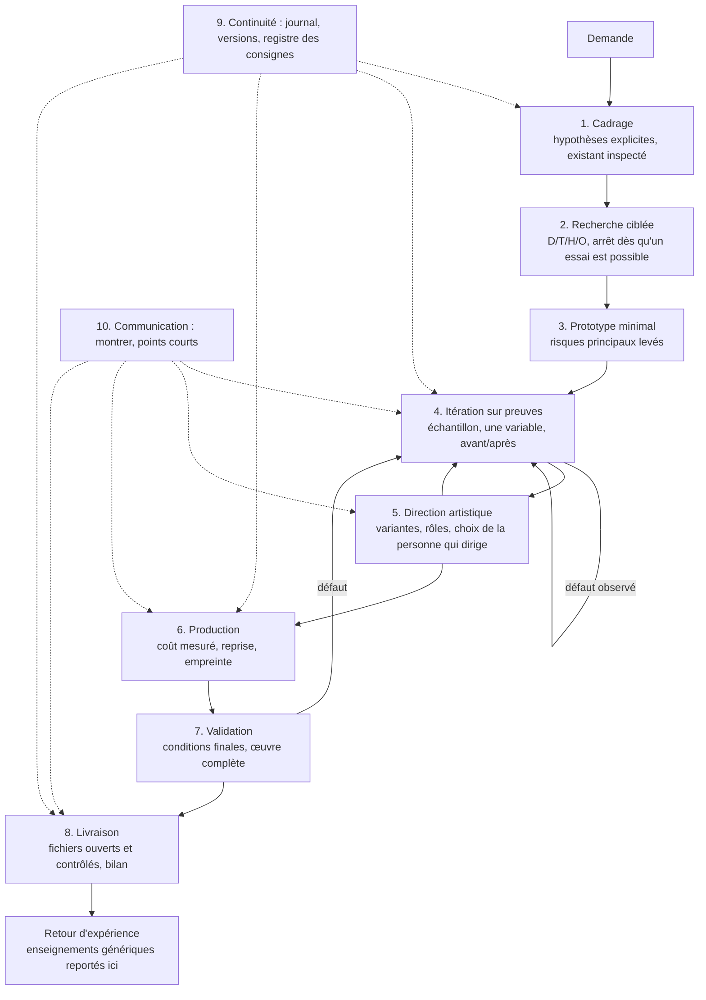

# Workflow : du besoin au résultat final

Ce dossier décrit **ce que l'on fait et dans quel ordre**. Chaque étape a ses entrées, ses sorties, un critère de fin
et des contrôles. Les [principes](../principles.md) justifient ces choix.

## Vue d'ensemble

Ce n'est pas une cascade : l'itération (4) et la direction artistique (5) bouclent jusqu'à la validation de la
personne qui dirige ; la validation (7) peut renvoyer à l'itération ; la continuité (9) et la communication (10)
traversent tout.

## Les étapes

| # | Étape | Question | Critère de fin |
|---|---|---|---|
| 1 | [Cadrage](01-scoping.md) | Que veut-on vraiment, avec quoi, sous quelles contraintes ? | Objectif reformulé, existant inspecté, hypothèses écrites, questions bloquantes isolées |
| 2 | [Recherche](02-research.md) | Comment ce problème a-t-il été résolu ailleurs, et qu'est-ce qui est prouvé ? | Une méthode testable par sujet, avec son statut D/T/H/O |
| 3 | [Prototype](03-prototyping.md) | Les risques principaux sont-ils maîtrisables ? | Chaque risque vérifié sur un cas minimal, coût mesuré |
| 4 | [Itération sur preuves](04-evidence-based-iteration.md) | Ce changement améliore-t-il réellement le résultat ? | Avant/après comparé, défaut corrigé à la cause |
| 5 | [Direction artistique](05-art-direction.md) | Quelle proposition sert le mieux l'intention ? | Choix explicite de la personne qui dirige |
| 6 | [Production](06-production.md) | Comment produire le tout de façon fiable et en temps raisonnable ? | Œuvre complète produite par une chaîne reprenable |
| 7 | [Validation](07-validation.md) | Le résultat complet tient-il dans les conditions finales ? | Contrôles de l'œuvre complète passés, lecture réelle vérifiée |
| 8 | [Livraison](08-delivery.md) | Qu'est-ce qui est remis, testé et limité ? | Définition de « terminé » satisfaite, bilan rendu |
| 9 | [Continuité](09-continuity.md) | Peut-on reprendre sans la conversation ? | Journal et registre à jour, version archivée |
| 10 | [Communication](10-communication.md) | La personne qui dirige voit-elle ce qu'il faut pour décider ? | Résultat montré, point court, prochaine action |

## Enchaînements types [éprouvé]

**Projet neuf.** Étude de faisabilité sans implémentation, puis décision de livraison complète, puis une suite de
versions. Chaque version s'ouvre par une reprise de l'existant : archivage de l'état courant, sorties séparées,
corrections ciblées, démonstration avant le calcul long, production finale.

**Correction ciblée.** Sur un échantillon : recherche ciblée → essai isolé → comparaison visuelle → intégration, sans
relancer la production complète.

**Régression.** Confirmer par une mesure, localiser l'étape où naît le défaut, isoler les causes une à une, corriger,
puis comparer trois états à vitesse normale : avant la régression, version actuelle, version corrigée.

**Optimisation.** Profiler le coût, comparer quelques profils cohérents sur les mêmes unités, valider un extrait réel
de la production avant de lancer le tout.

**Application logicielle.** Un chantier s'ouvre sur une branche avec son journal ; chaque changement passe par un test
écrit d'abord, puis l'implémentation et les vérifications citées ; la documentation suit dans le même commit ; la
fusion se fait sur demande. Voir [le guide applications web](../domains/web-applications.md).

## Adapter

Les étapes sont génériques ; leur contenu dépend du domaine. Voir [`adapting.md`](adapting.md).
