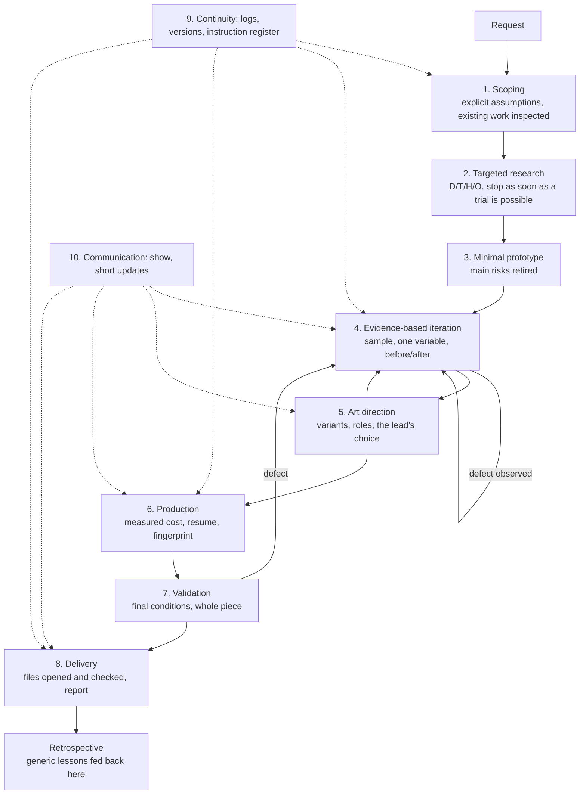

# Workflow: from request to final result

This folder describes **what to do and in which order**. Each step has inputs, outputs, an exit criterion and checks.
The [principles](../principles.md) justify these choices.

## Overview

This is not a waterfall: iteration (4) and art direction (5) loop until the lead approves; validation (7) can send the
work back to iteration; continuity (9) and communication (10) run through everything.

## The steps

| # | Step | Question | Exit criterion |
|---|---|---|---|
| 1 | [Scoping](01-scoping.md) | What is really wanted, with what, under which constraints? | Objective restated, existing work inspected, assumptions written, blocking questions isolated |
| 2 | [Research](02-research.md) | How was this solved elsewhere, and what is proven? | One testable method per topic, with its D/T/H/O status |
| 3 | [Prototype](03-prototyping.md) | Are the main risks manageable? | Each risk checked on a minimal case, cost measured |
| 4 | [Evidence-based iteration](04-evidence-based-iteration.md) | Does this change really improve the result? | Before/after compared, defect fixed at its cause |
| 5 | [Art direction](05-art-direction.md) | Which proposal best serves the intent? | Explicit choice by the lead |
| 6 | [Production](06-production.md) | How do we produce the whole reliably and in reasonable time? | Whole piece produced by a resumable pipeline |
| 7 | [Validation](07-validation.md) | Does the complete result hold in final conditions? | Whole-piece checks passed, real playback verified |
| 8 | [Delivery](08-delivery.md) | What is handed over, tested and limited? | Definition of done met, report delivered |
| 9 | [Continuity](09-continuity.md) | Can someone resume without the conversation? | Logs and register up to date, version archived |
| 10 | [Communication](10-communication.md) | Does the lead see what they need to decide? | Result shown, short update, next action |

## Typical sequences [proven]

**New project.** A feasibility study without implementation, then a decision to deliver in full, then a series of
versions. Each version starts by taking stock of the existing work: archive the current state, separate outputs,
targeted fixes, demonstration before the long computation, final production.

**Targeted fix.** On a sample: targeted research → isolated trial → visual comparison → integration, without
relaunching the full production.

**Regression.** Confirm with a measurement, locate the stage where the defect originates, isolate causes one by one,
fix, then compare three states at normal speed: before the regression, current version, fixed version.

**Optimization.** Profile the cost, compare a few consistent profiles on the same units, validate a real excerpt of
the production before launching the whole.

**Software application.** A workstream opens on a branch with its log; every change goes through a test written
first, then the implementation and the quoted checks; documentation follows in the same commit; merging happens on
request. See the [web applications guide](../domains/web-applications.md).

## Adapting

The steps are generic; their content depends on the domain. See [`adapting.md`](adapting.md).
